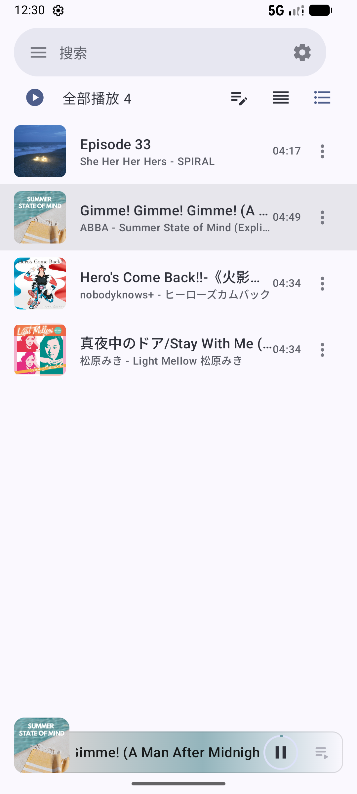
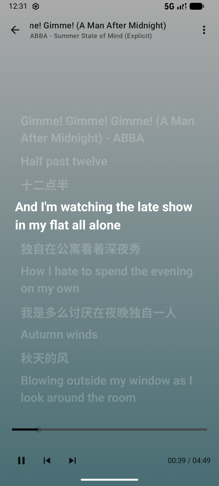
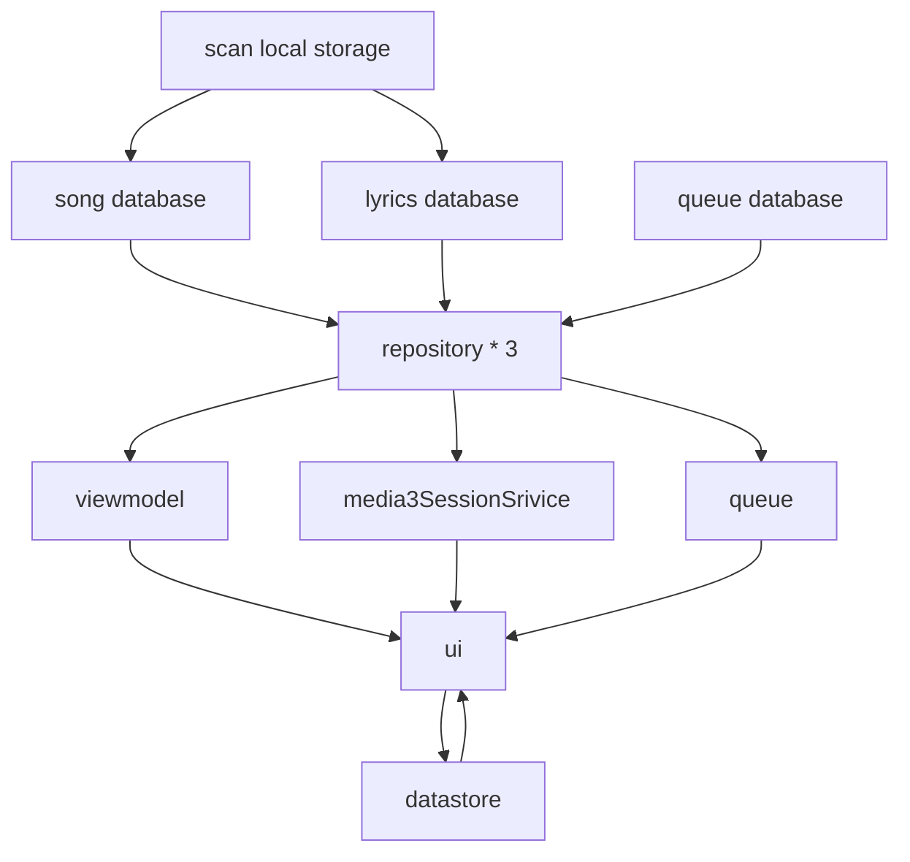

# SampleAudio

简易本地音乐，获取所有文件权限即可扫描使用

## 下载安装

## 功能特性

- **基本功能**: 音频播放与搜索、列表、队列、详情、扫描文件、定时器、黑白主题

- **本地缓存**: 使用 Room 数据库记忆扫描位置

## 运行截图

| 首页 | 主控制页                                                                              | 歌词页 |
| --- |---------------------------------------------------------------------------------|--- |
|  |  | |

## 架构



## 技术栈

以 kotlin 为开发语言，compose 为界面的基础，使用 media3 compose 作主题。利用 libvlc-android 作为播放器内核实现几乎音频全格式播放，把 medi3sessionservice 作壳来简化service和通知栏音频控件的实现。

this project uses libvlc-android licensed under the LGPLv2.1 or later.

## 经历

主分支的第一个音乐app存在过多问题，比如最近任务清除音乐 app application 延迟回收，扫描页意外退出，service 负担严重等。对比现在分支的新音乐app ，同样以libvlc 为基础，新增 medi3sessionservice 优化 service 负担。同时新增queue,删除了 widget 。现在 queue 最近播放队列责任过大，作为本地app来说感觉没必要存在... 还不如直接用列表作为播放队列，这样顺序、随机、重复播放就落在列表上。

两个app都实现 viewmodel ,感觉这个中间代理不太友好，很啰嗦。如果直接以 flow 来生产， ui 来消费，这样就省去了 viewmodel ,但是如果用了协程，就要注意协程的生命周期和内存释放。理论上一个本地音乐app内存占用在20MB以内是最好的，目前是25MB左右。

## 开源协议

```text
Copyright [2026] [pointchange]

Licensed under the Apache License, Version 2.0 (the "License");
you may not use this file except in compliance with the License
You may obtain a copy of the License at

http://www.apache.org/licenses/LICENSE-2.0
```
